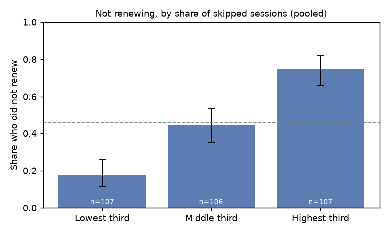
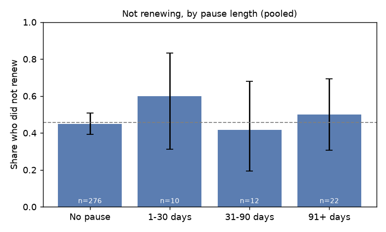
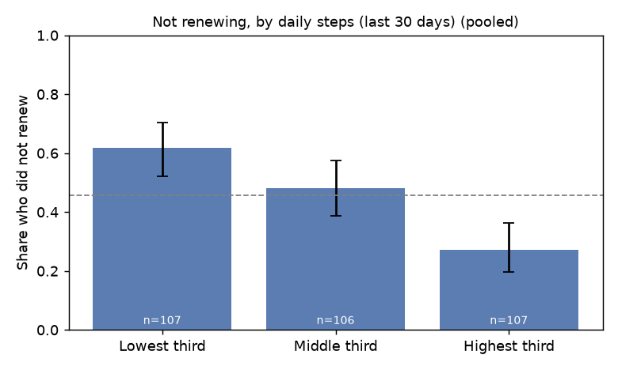
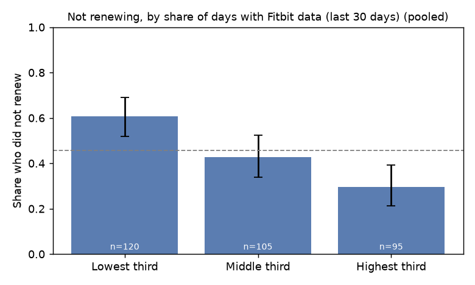
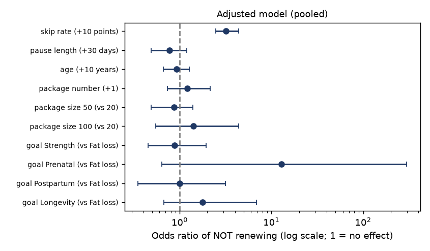

# What is associated with not renewing? (SYNTHETIC data)

**Read this first.** The data is synthetic. In the generator, renewal odds depend on how much of a package the client attended and on a hidden engagement level. Wearable activity and body measurements also follow that hidden engagement, but **nothing (pause length, activity or body measures) has a direct effect on renewal**. So these results show that the method behaves correctly (it finds what was built in, and does not invent what was not). They do **not** tell you what drives renewal at a real gym. The same code can be rerun on real, consented data.

## Your questions

**1. Are frequently skipped sessions associated with not renewing?**

- 35-client cohort (36 finished packages): Yes: more skipped sessions went with more non-renewal (AUC 0.84; 95% CI 0.67 to 0.95; Holm-adjusted p = 0.00591).
- Pooled cohorts (320 finished packages): Yes: more skipped sessions went with more non-renewal (AUC 0.79; 95% CI 0.73 to 0.83; Holm-adjusted p = 9.23e-18).

**2. Is a longer pause associated with not renewing?**

- 35-client cohort: Only 5 packages are in this group, too few to judge.
- Pooled cohorts: No clear association (AUC 0.51; 95% CI 0.47 to 0.55; Holm-adjusted p = 1; 44 packages in the group).

**How much pause data is needed?** The method was tested by planting a known pause effect in synthetic data (table below). Weak effects need hundreds of clients to detect, so a null result on a small real sample means 'cannot tell', not 'no effect'.

| Planted effect (renewal odds change per 30 days paused) | Cohorts pooled per trial (35 clients each) | Trials where a pause effect was flagged | Avg packages with a pause |
|---|---|---|---|
| 0.0 | 8 | 0/8 | 68.875 |
| 0.15 | 8 | 2/8 | 70.25 |
| 0.3 | 8 | 8/8 | 70.875 |

**3. Does activity outside the gym (the most recent 30 days) go with renewal?**

Activity is measured over the 30 days before the package finished, matching the 30 days a Fitbit file holds.

- Daily steps, 35-client cohort: No clear association (AUC 0.43; 95% CI 0.24 to 0.62; Holm-adjusted p = 0.99; 36 packages in the group).
- Daily steps, pooled: Clients who were more active in the last 30 days were less likely to leave (AUC 0.32; 95% CI 0.26 to 0.39; Holm-adjusted p = 1.82e-07). After accounting for skipped sessions, it still adds information beyond skipped sessions (odds ratio 0.71 per 1 SD, 95% CI 0.52 to 0.92).
- Checking in (share of days with Fitbit data), pooled: Clients who checked in more often were less likely to leave (AUC 0.32; 95% CI 0.27 to 0.38; Holm-adjusted p = 1.82e-07). After accounting for skipped sessions, it adds nothing clear beyond skipped sessions (odds ratio 0.78 per 1 SD, 95% CI 0.57 to 1.03).
- Step trend inside the 30 days, pooled: No clear association (AUC 0.50; 95% CI 0.43 to 0.57; Holm-adjusted p = 0.88; 320 packages in the group).

**4. Do body measurements go with renewal?** (body weight, body fat %, skeletal muscle mass)

- Starting values (pooled): body weight: no clear association; body fat %: no clear association; muscle mass: no clear association.
- Change over the package (pooled): body weight: no clear association; body fat %: no clear association; muscle mass: no clear association.
- Moved in the goal direction: No clear association (44% vs 52% did not renew (198 vs 42 packages); 95% CI -0.24 to 0.08; Holm-adjusted p = 1; 42 packages in the group).

The 'beyond skipped sessions' checks are exploratory: 11 factors are checked and the intervals are not corrected for that, so an occasional false alarm is expected (about 1 in 20).

## Does activity improve the prediction model?

Cross-validated AUC (grouped by client, repeated over different splits; 0.5 is a coin flip). A difference smaller than the spread is not a real improvement.

| Model | Inputs | AUC | Spread (+/-) | Packages |
|---|---|---|---|---|
| Gym attendance only | 18 | 0.735 | 0.05 | 274 |
| Gym attendance + activity, last 30 days | 22 | 0.749 | 0.05 | 274 |

## Full results: pooled cohorts

| Family | Factor | Cases | Effect | CI low | CI high | p | p (Holm) | Verdict |
|---|---|---|---|---|---|---|---|---|
| Gym and pauses | Skipped sessions (share of bookings not attended) | 320 | AUC 0.79 | 0.73 | 0.829 | <0.001 | <0.001 | More non-renewal |
| Gym and pauses | Late cancels + no-shows (share of bookings) | 306 | AUC 0.68 | 0.623 | 0.737 | <0.001 | <0.001 | More non-renewal |
| Gym and pauses | Early cancels (share of bookings) | 319 | AUC 0.75 | 0.694 | 0.795 | <0.001 | <0.001 | More non-renewal |
| Gym and pauses | Pause length, all packages (days; 0 if none) | 44 | AUC 0.51 | 0.469 | 0.547 | 0.631 | 1.000 | No clear association |
| Gym and pauses | Pause length, only packages with a pause (days) | 44 | AUC 0.35 | 0.176 | 0.551 | 0.095 | 0.570 | No clear association |
| Gym and pauses | Package number (1 = first) | 320 | AUC 0.48 | 0.43 | 0.528 | 0.426 | 1.000 | No clear association |
| Gym and pauses | Age | 320 | AUC 0.50 | 0.427 | 0.553 | 0.930 | 1.000 | No clear association |
| Gym and pauses | Had any pause | 44 | 50% vs 45% did not renew (44 vs 276 packages) | -0.128 | 0.21 | 0.625 | 1.000 | No clear association |
| Gym and pauses | Had a maternity pause | 22 | 50% vs 45% did not renew (22 vs 298 packages) | -0.187 | 0.272 | 0.825 | 1.000 | No clear association |
| Activity outside the gym (last 30 days) | Average daily steps, last 30 days | 320 | AUC 0.32 | 0.264 | 0.385 | <0.001 | <0.001 | Less non-renewal |
| Activity outside the gym (last 30 days) | Active minutes per day, last 30 days | 320 | AUC 0.34 | 0.275 | 0.401 | <0.001 | <0.001 | Less non-renewal |
| Activity outside the gym (last 30 days) | Share of days with Fitbit data (checking in), last 30 days | 320 | AUC 0.32 | 0.268 | 0.385 | <0.001 | <0.001 | Less non-renewal |
| Activity outside the gym (last 30 days) | Step trend within the last 30 days (second half vs first half) | 320 | AUC 0.50 | 0.43 | 0.565 | 0.879 | 0.879 | No clear association |
| Body measurements | Body weight at start of package (kg) | 320 | AUC 0.50 | 0.434 | 0.552 | 0.905 | 1.000 | No clear association |
| Body measurements | Body fat % at start of package | 320 | AUC 0.52 | 0.453 | 0.582 | 0.567 | 1.000 | No clear association |
| Body measurements | Skeletal muscle mass at start of package (kg) | 320 | AUC 0.50 | 0.432 | 0.557 | 0.974 | 1.000 | No clear association |
| Body measurements | Change in body weight over the package (kg) | 262 | AUC 0.57 | 0.491 | 0.625 | 0.067 | 0.403 | No clear association |
| Body measurements | Change in body fat % over the package (points) | 262 | AUC 0.53 | 0.46 | 0.601 | 0.422 | 1.000 | No clear association |
| Body measurements | Change in skeletal muscle mass over the package (kg) | 262 | AUC 0.42 | 0.349 | 0.482 | 0.023 | 0.160 | No clear association |
| Body measurements | Moved in the goal direction (body fat down for fat loss/postpartum; muscle up for strength/longevity) | 42 | 44% vs 52% did not renew (198 vs 42 packages) | -0.244 | 0.08 | 0.396 | 1.000 | No clear association |

Effect is AUC (0.5 = no association; above 0.5 = higher values go with not renewing) for continuous factors, and the difference in non-renewal rate for yes/no factors. CIs resample whole clients. Holm correction is applied within each family of tests.

## Do activity and measurement factors add anything beyond skipped sessions? (pooled, exploratory)

| Factor | n | Odds ratio per 1 SD | CI low | CI high | Adds beyond skip rate |
|---|---|---|---|---|---|
| Average daily steps, last 30 days | 320 | 0.71 | 0.52 | 0.92 | True |
| Active minutes per day, last 30 days | 320 | 0.74 | 0.55 | 0.96 | True |
| Share of days with Fitbit data (checking in), last 30 days | 320 | 0.78 | 0.57 | 1.03 | False |
| Step trend within the last 30 days (second half vs first half) | 320 | 1.05 | 0.81 | 1.42 | False |
| Body weight at start of package (kg) | 320 | 0.89 | 0.67 | 1.09 | False |
| Body fat % at start of package | 320 | 1.15 | 0.88 | 1.47 | False |
| Skeletal muscle mass at start of package (kg) | 320 | 0.9 | 0.7 | 1.14 | False |
| Change in body weight over the package (kg) | 262 | 1.29 | 0.99 | 1.76 | False |
| Change in body fat % over the package (points) | 262 | 1.1 | 0.86 | 1.56 | False |
| Change in skeletal muscle mass over the package (kg) | 262 | 0.65 | 0.46 | 0.87 | True |
| Moved in the goal direction (body fat down for fat loss/postpartum; muscle up for strength/longevity) | 240 | 0.9 | 0.66 | 1.18 | False |

## Full results: the 35-client cohort

| Family | Factor | Cases | Effect | CI low | CI high | p | p (Holm) | Verdict |
|---|---|---|---|---|---|---|---|---|
| Gym and pauses | Skipped sessions (share of bookings not attended) | 36 | AUC 0.84 | 0.665 | 0.955 | <0.001 | 0.006 | More non-renewal |
| Gym and pauses | Late cancels + no-shows (share of bookings) | 33 | AUC 0.66 | 0.505 | 0.821 | 0.101 | 0.706 | No clear association |
| Gym and pauses | Early cancels (share of bookings) | 36 | AUC 0.79 | 0.609 | 0.945 | 0.003 | 0.023 | More non-renewal |
| Gym and pauses | Pause length, all packages (days; 0 if none) | 5 | AUC 0.48 | 0.371 | 0.582 | 0.812 | 1.000 | Too few cases to judge (5) |
| Gym and pauses | Pause length, only packages with a pause (days) | 5 | AUC 0.33 | 0.0 | 1.0 | 0.800 | 1.000 | Too few cases to judge (5) |
| Gym and pauses | Package number (1 = first) | 36 | AUC 0.57 | 0.426 | 0.735 | 0.383 | 1.000 | No clear association |
| Gym and pauses | Age | 36 | AUC 0.59 | 0.408 | 0.772 | 0.363 | 1.000 | No clear association |
| Gym and pauses | Had any pause | 5 | 40% vs 45% did not renew (5 vs 31 packages) | -0.5 | 0.466 | 1.000 | 1.000 | Too few cases to judge (5) |
| Gym and pauses | Had a maternity pause | 2 | 50% vs 44% did not renew (2 vs 34 packages) | -0.543 | 0.649 | 1.000 | 1.000 | Too few cases to judge (2) |
| Activity outside the gym (last 30 days) | Average daily steps, last 30 days | 36 | AUC 0.43 | 0.236 | 0.616 | 0.454 | 0.986 | No clear association |
| Activity outside the gym (last 30 days) | Active minutes per day, last 30 days | 36 | AUC 0.48 | 0.279 | 0.694 | 0.836 | 0.986 | No clear association |
| Activity outside the gym (last 30 days) | Share of days with Fitbit data (checking in), last 30 days | 36 | AUC 0.40 | 0.21 | 0.593 | 0.329 | 0.986 | No clear association |
| Activity outside the gym (last 30 days) | Step trend within the last 30 days (second half vs first half) | 36 | AUC 0.32 | 0.097 | 0.52 | 0.063 | 0.250 | No clear association |
| Body measurements | Body weight at start of package (kg) | 36 | AUC 0.50 | 0.296 | 0.685 | 1.000 | 1.000 | No clear association |
| Body measurements | Body fat % at start of package | 36 | AUC 0.56 | 0.403 | 0.714 | 0.535 | 1.000 | No clear association |
| Body measurements | Skeletal muscle mass at start of package (kg) | 36 | AUC 0.52 | 0.348 | 0.691 | 0.886 | 1.000 | No clear association |
| Body measurements | Change in body weight over the package (kg) | 28 | AUC 0.60 | 0.389 | 0.801 | 0.378 | 1.000 | No clear association |
| Body measurements | Change in body fat % over the package (points) | 28 | AUC 0.37 | 0.173 | 0.58 | 0.255 | 1.000 | No clear association |
| Body measurements | Change in skeletal muscle mass over the package (kg) | 28 | AUC 0.34 | 0.144 | 0.561 | 0.156 | 1.000 | No clear association |
| Body measurements | Moved in the goal direction (body fat down for fat loss/postpartum; muscle up for strength/longevity) | 4 | 41% vs 50% did not renew (22 vs 4 packages) | -0.652 | 0.449 | 1.000 | 1.000 | Too few cases to judge (4) |

## Adjusted model (pooled)

Odds ratios of not renewing, each adjusted for the others. n = 320, events = 146, grouped cross-validation AUC = 0.77.

| Factor | Odds ratio | CI low | CI high | CI excludes 1 |
|---|---|---|---|---|
| skip rate (+10 points) | 3.19 | 2.46 | 4.39 | True |
| pause length (+30 days) | 0.77 | 0.49 | 1.19 | False |
| age (+10 years) | 0.92 | 0.66 | 1.28 | False |
| package number (+1) | 1.21 | 0.73 | 2.16 | False |
| package size 50 (vs 20) | 0.87 | 0.49 | 1.4 | False |
| package size 100 (vs 20) | 1.41 | 0.55 | 4.41 | False |
| goal Strength (vs Fat loss) | 0.88 | 0.45 | 1.94 | False |
| goal Prenatal (vs Fat loss) | 12.8 | 0.64 | 298.34 | False |
| goal Postpartum (vs Fat loss) | 1.01 | 0.35 | 3.18 | False |
| goal Longevity (vs Fat loss) | 1.78 | 0.68 | 6.89 | False |

## Limits

- Associations, not causes. A client who skips sessions or has fewer Fitbit days may be losing interest for reasons the data does not show.
- Only finished packages with a renewal decision are included. There is no lapse rule, so clients who stop attending have no outcome and are missing from this analysis. Record a closure status in real data to include them.
- When real Fitbit series are attached to made-up clients (`--fitbit`), that activity has no real link to those clients' bookings, so it only demonstrates the plumbing.
- Body measures need consent and are not appropriate to track for every client (for example where there is a history of disordered eating).
- A maternity pause is a life stage, not disengagement; it is included so its association can be examined, but very few cases exist.
- Synthetic data: results show the method works, not how real clients behave.